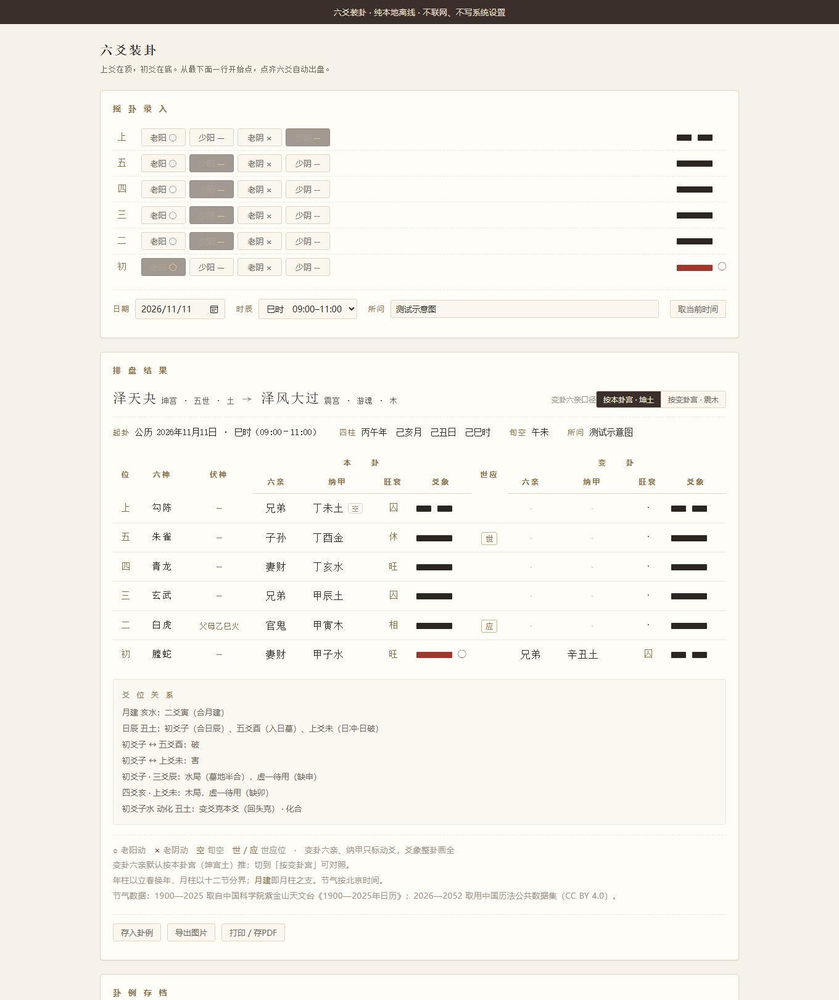
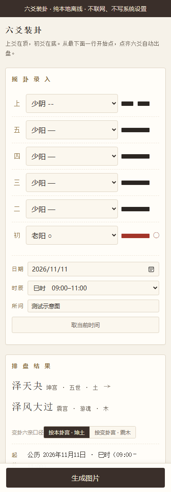
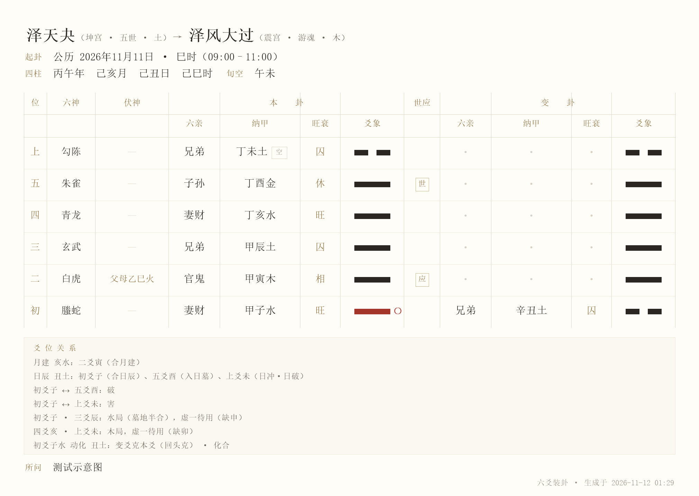

# 六爻装卦

一个单文件的离线六爻装卦工具。电脑和手机都能用，联网不联网都能用。

它只做一件事：**装卦**。

---

## 界面

**电脑端**

**手机端**

**导出的图片**

> 截图中的「测试示意图」是示例内容。

---

## 为什么做这个

市面上的六爻 App 大多在做两件事：帮你起卦、帮你解读。这两件我都不做。

- **起卦不代劳。** 摇卦要事主亲手摇。工具代摇、随机生成、按时间起卦，都是在削弱这一步。
- **解读不越界。** 断卦要懂卦的人来断。工具自动生成的解读，会误导不懂六爻的事主。

所以它只到装卦为止。卦辞爻辞、吉凶断语、自动解读，一概没有。

---

## 两种用法

| 方式 | 怎么用 | 要不要网络 | 适合 |
|---|---|---|---|
| **离线（本地文件）** | 下载 HTML，双击打开 | 完全不要 | 自己长期用、断网环境 |
| **在线（网址）** | 浏览器打开一个网址 | 首次要，之后自动缓存，断网也能打开 | 发给别人、手机随时用 |

在线版打开过一次就会把整页存进浏览器缓存，此后不联网也能用，还能「添加到主屏幕」，像 App 一样点开。

> 微信内置浏览器能打开在线版，但**不会缓存**——想离线得用系统浏览器打开。

---

## 电脑端和手机端

同一份文件，两种布局，自动切换。

| | 电脑 | 手机 |
|---|---|---|
| 录入 | 每爻四个按钮，点一下即选 | 每爻一个下拉，原生选择器 |
| 看盘 | 整张表一屏铺开 | 表格可左右滑动 |
| 出图 | 「导出图片」存成 PNG 文件 | 底部「生成图片」，弹出成品图，**长按存相册** |
| 分享 | 存成文件再发 | 长按图直接转发到微信 |
| 打印 | 支持，A4 横向一页 | 不适用 |
| 存档 | 支持 | 支持（建议以出图为主） |

手机端的设计取舍：**屏幕上的盘不用看得太细，因为最终交付物是那张图。** 录入要快、要准，看图交给成品图。

---

## 时间与节气

- **起卦时间**默认抓取本机时间，也可以手动改；工具不做任何时区换算，输入什么就是什么。
- **节气时刻一律按北京时间**（紫金山天文台口径）。所以当你录入的是求卦人当地时间、而求卦人不在东八区时，交节判定的边界会随之偏移。
- **交节正好落在所选时辰内**时，工具会自动标出是哪个节气、几点几分，并让你选「交节前 / 交节后」——月柱会因此不同，这一步不替你猜。

> [!CAUTION]
> **子时不占。**
>
> 这是作者自用的原则，不是疏漏：时辰选项里**没有子时**。如果打开时本机正处于子时，工具会留空并提示手选。
>
> 市面上绝大多数排盘工具都会给你十二个时辰，这一个只给十一个。

---

## 四个特点

**一、极轻。**

单文件，约 98 KB，零依赖、零构建、零安装。双击就能用，十年后双击还是能用——没有 npm 包会失效，没有构建链会坏掉。

**二、历法信源权威。**

节气数据 1900—2025 取自**中国科学院紫金山天文台**《1900—2025年日历》，逐条比对 3024 个节气，与官方值**分钟级完全一致**。

年柱以立春换年，月柱以十二节分界，不是按农历月份换算。

**三、规则只依一本书。**

装卦规则主体只遵循《增删卜易》一部，不拼几家口径，所以逻辑是自洽的——不会出现这一格按 A 书、那一格按 B 书，两处打架。

书中未载或明确不录的少数几项（六害、六破、半合、月墓），工具仍然保留，但在下文「口径与依据」里逐条标明了出处，不混在书里的规则中。

**四、盘面信息完整。**

见下一节。

---

## 盘面包含什么

**盘头**：本卦与变卦卦名、卦宫、几世卦、宫五行；六冲卦／六合卦标注；起卦公历时间与时辰；四柱；旬空。

**本卦六爻**：六神、伏神、六亲、纳甲干支、旺衰、爻象、世应。

**变卦**：六亲、纳甲、旺衰、爻象（动爻处）。

**盘下「爻位关系」**：

- 月建、日辰：冲、合、临、入墓；被日冲的静爻按旺衰分「暗动」与「日破」
- 爻与爻：冲、六合（带合化五行）、害、破、刑、自刑
- 三合、半合：按书中成局四法判定，并注明成局与否、缺哪一支
- 入墓：月墓、日墓、动墓、化墓
- 反吟、伏吟：分内外卦
- 动爻回头：回头生、回头克、泄、制、化冲、化合

**操作**：存入卦例、导出图片、打印／存 PDF。

---

## 口径与依据

以《增删卜易》为准，书外补充逐条标明：

| 项目 | 依据 |
|---|---|
| 八宫、纳甲、六亲、世应、六神、伏神 | 《增删卜易》 |
| 年柱按立春，月柱按十二节 | 《增删卜易》＋官方历法 |
| 三墓 | 书定「日墓、动墓、化墓」；另加**月墓**（书外，按使用习惯） |
| 六害 | 书称「六害全无应验，删之不录」；本工具仍标注 |
| 六破、半合 | 书外补充 |
| 旺衰 | 旺、相、休、囚、死 五档 |
| 三合成局 | 按书中「成局四法」判定，并注明是否成局 |
| 暗动 / 日破 | 《暗动章》：静爻旺相被日冲为暗动，休囚为日破 |

口径有分歧的地方不替你决定：交节正好落在所选时辰内时，工具会弹出「交节前／交节后」让你选。

---

## 数据来源

- **节气 1900—2025**：中国科学院紫金山天文台《1900—2025年日历》。逐条比对 3024 个节气，与官方值分钟级完全一致。
- **节气 2026—2052**：中国历法公共数据集（作者邝楚嘉，CC BY 4.0）。此段未与官方值比对。

---

## 已知边界

- 节气表止于 **2052** 年。之后可排日柱、时柱、装卦，但无月建，也没有旺衰与月墓——工具会明说，不瞎补。
- 存档存在浏览器本地。清缓存会丢，请定期「导出全部备份」。
- 手机端盘面需要横向滑动才能看全；看不清就出图。
- 只装卦，不含卦辞爻辞与任何解读。

---

## 许可

代码以 **MIT** 许可发布。

节气数据中 2026—2052 部分来自 CC BY 4.0 数据集，署名见「数据来源」一节；该部分不因并入本项目而改变许可。

## 反馈

问题与建议请开 Issue。
